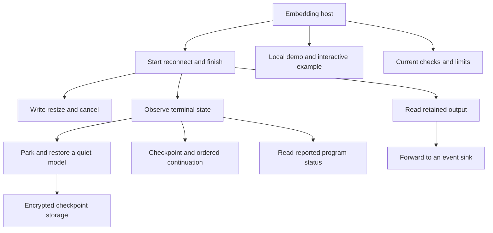

# Keep a command alive while its viewers change

PTY Runtime owns a Unix pseudo-terminal: a process connection that behaves like
a terminal, including interactive input, output and window size. Keep one Runtime
in a long-lived host, spawn a shell once, and reconnect viewers to that same
session. The host supplies authorization and transport. Restarting the host does
not restore running sessions.

For example, a backend starts `build-shell`, gives a viewer an attachment, and
keeps the Runtime when the viewer disconnects. On reconnect it uses `lookup` and
the viewer's cursor. Lost old output produces an explicit gap, not a fresh child.
To stop work, cancel deliberately and inspect both child and output-drain results.
The [session recipe](sessions.md) explains these steps and retained-ID cleanup.

Raw sessions expose bytes. Projected sessions also maintain one authoritative
terminal model, the grid and parser state used to interpret those bytes. Parking
replaces that model with a checkpoint while process ownership continues. Neither
a checkpoint nor a finished observation proves successful command execution.

The local demo has different connection ownership and a separately owned terminal;
read [its flow](demo.md) before using it as a backend example. The
[feature inventory](inventory.md) covers the public surface, adapters, tools and
explicitly proposed integrations. [Evidence](verification.md) separates current
checks from historical experiments and unmet release qualification.
