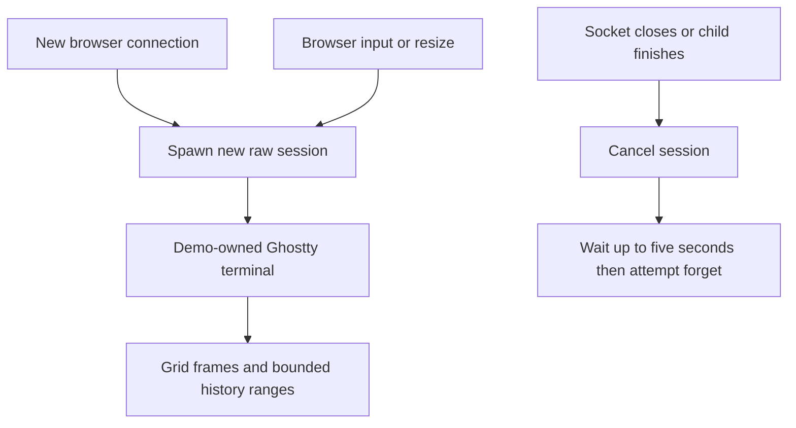

# Try a shell without confusing demo ownership with reconnect

The local demo server binds loopback and renders terminal grids in a browser.
It creates Runtime before Tokio workers. Each connection gets a new raw session
and a separately owned Ghostty terminal. The browser paints grids and holds its
own viewing position; this path does not exercise the library's projected-session
parking/restore coordinator or persistent backend reconnect.

## Disconnect ends this demo session

The worker explicitly requests cancellation, polls a completion wait for up to
five seconds, then attempts forget. It ignores forget failure. If completion
wait admission fails or the deadline expires, the registry entry may remain and
consume a session slot; this path does not guarantee cleanup before returning.
A later connection uses a new ID. Dropping a
library attachment alone would not do that. Do not use browser refresh as a
reconnect guarantee. For a persistent backend, follow the [embedding ownership
recipe](sessions.md) and supply authenticated transport/session lookup yourself.

The demo queues paste input in chunks and uses actual written counts. Image paste
writes a temporary file and inserts its path; it does not embed image support in
the library's terminal state. History requests read the demo's terminal port,
with shifting window-relative rows and bounded requested count. Wire conversion
uses style tables and grid data; it is a demo protocol, not a public remote-service
security contract. No current browser interaction run is claimed in this atlas.

The separate interactive example forwards a real raw session through the host
terminal and restores local terminal settings on cleanup. The mechanical gate
includes its scripted smoke. A workspace-sdk adapter remains a proposed sketch
under [examples](../examples/workspace-sdk-integration.md), not shipped transport.
