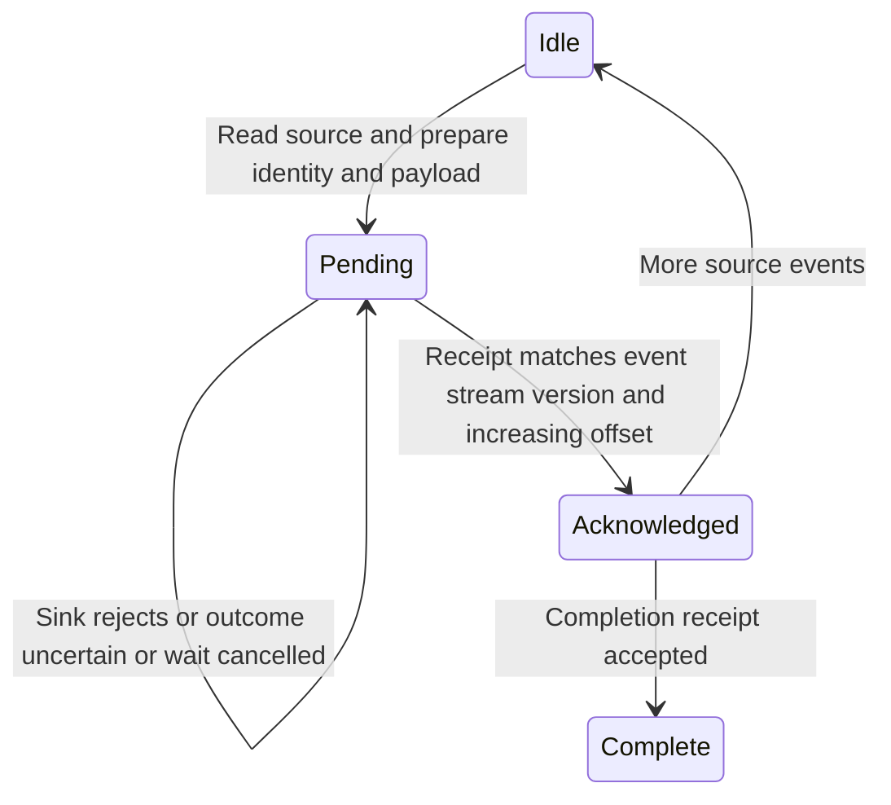

# Forward output to a caller-owned event sink

Enable the optional event-stream feature, resolve a stream incarnation, and create
EventStreamPublisher from an admitted raw attachment and your sink. Drive
`publish_next()` yourself. It creates no background worker or implicit store.
The [reconnect example](../../examples/event_stream_reconnect.rs) uses the real
pinned dependency to demonstrate replay, gaps and subscription reconnect.

## Retry the retained publication

A lost reply may mean the sink committed. Keep the publisher and call publish_next
again to retry its exact pending identity/schema/payload; pending_event_id helps
reconciliation. The source attachment may already have advanced, but the
acknowledged byte cursor advances only after a validated receipt. An invalid
receipt leaves pending state intact. Dropping the publisher loses that retry
identity and does not undo accepted sink work. A replacement publisher does not
promise deduplication of the old uncertain append.

Use event-store cursors to resume event subscriptions; PTY byte cursors identify
original output positions and have a different lifetime. One publisher retains
one bounded pending record. External queues and retention have separate budgets.
A stalled sink can let raw replay age out, producing an exact gap later; it does
not become authoritative parser staging. Retrying capacity errors is a caller
policy, not silent eviction of the sink.

PublicationReceipt models one prepared record and independent matching/mismatching
receipts. It checks acknowledgement requires a matching receipt and uncertain
attempts retain pending identity. Stream/version/offset validation is abstracted
into receipt validity; sink idempotency and crash persistence are not proved.
