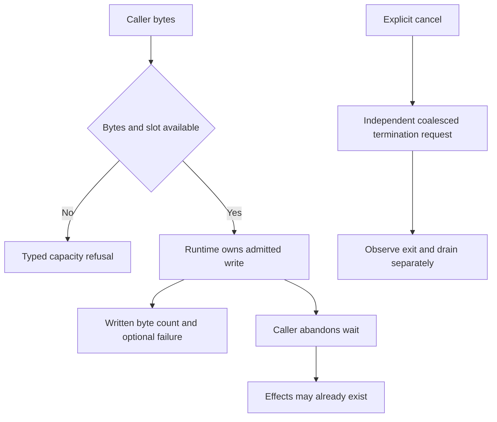

# Send input without replaying an uncertain write

Suppose a viewer pastes a command and disconnects while the write is pending.
`Session::write` admits bounded work and returns an operation to await. Admission
is not proof that all bytes reached the pseudo-terminal. Dropping that wait does
not undo bytes already written, and does not authorize resending the whole paste.

## What to do after a partial or unknown write

Inspect WriteOutcome's written count and failure when available. A successful
OS write still does not prove the child application accepted the command. A host
may continue a known unwritten suffix under its application policy; an unknown
outcome requires application reconciliation, not a blanket retry. Input chunks,
bytes and operations have independent finite limits, including abandoned waits.

`cancel()` records intent and dispatches through a control path independent of
input congestion. It returns no completion receipt. Request admission can precede
a later process-boundary error; inspect status and wait rather than infer that an
error erased intent. Cancellation requests coalesce; completion retains actual
exit and drain facts. The Guardian handles ordinary finite same-session jobs;
this is not a sandbox for malicious session escape.

## Resize both sides when projection is enabled

Raw sessions use `resize`. Projected sessions require `resize_projected`, ordered
with parser output. ResizeOutcome exposes OS and model results separately; an
OS resize can succeed while model work fails. Dropping the wait does not undo an
admitted resize. Do not show a fully synchronized terminal after a partial result;
check projection status and surface its failure. The atlas has no model proving
OS write atomicity, control timing or process cleanup.

## Choose command authority before spawning

CommandSpec takes absolute executable and working-directory paths and literal
arguments, with bounded metadata and rejected NUL bytes. It does not add a shell
wrapper. A caller that explicitly chooses a shell still owns that shell's parsing
policy. The environment starts empty by default; opt into inheritance deliberately,
then apply removals and final overrides. Debug redacts command/environment fields,
but a child can print sensitive input into ordinary terminal output.

The Unix adapter validates the canonical working directory against configured
launch roots. This is a launch-path policy, not a filesystem sandbox or executable
allowlist. Commands run with the host account's authority. The embedding host must
authorize remote commands, session lookup and input separately. Guardian helpers
provide process ownership and supervision within the documented finite same-session
job scope; they do not make untrusted programs safe to run.
