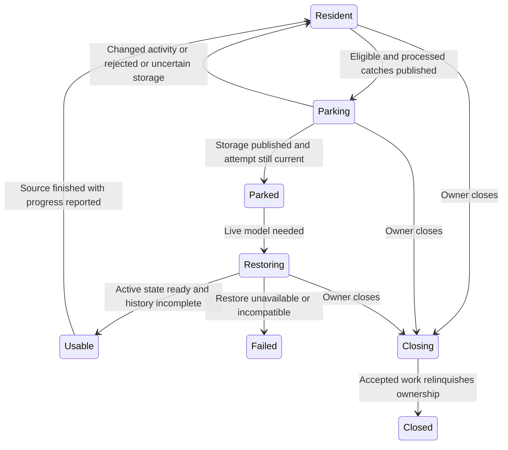

# Let a quiet terminal release native memory

Projected sessions become eligible to park after 60 seconds without output or
another model mutation by default. Parking replaces the terminal model with an
encrypted checkpoint; the child, reader, input and cancellation remain owned.
This policy threshold is not a measured optimum or total-memory guarantee.

## Keep the live model until publication is safe

An attempt records operation generation, activity, processed byte position and
control generation. Slow storage runs outside native ownership. After a successful
commit, the application checks those values and pending work together before
releasing the live model. Output arriving meanwhile invalidates the attempt;
its unused committed object goes to cleanup. Failed storage keeps the model.
An uncertain worker outcome may already have stored ciphertext: it remains
charged as unreclaimed instead of being treated as free capacity.

## Usable is not complete history

Restoration authenticates compatible state and creates a usable active screen,
then interleaves bounded older-history steps with live work. Live mutations may
make old pages inapplicable. Inspect history progress and skipped-page count;
Resident after finished decoding does not erase skipped history. Failed restore
preserves process ownership and bounded raw output, but cannot promise a usable
terminal. A compatible parked checkpoint can serve transfer without restoring the
server model. Already-encoded input need not restore it either.

ParkCommit models one attempt, one independent activity change, publication and
close. It checks release requires published storage, unchanged activity and open
ownership. It abstracts operation/control identity into that one activity token;
crypto, storage I/O, retry timing, native destruction and history are unmodeled.
