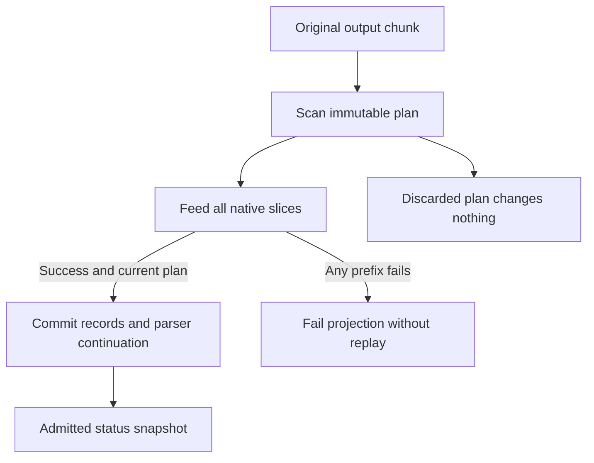

# Display a reported task state without treating it as authority

A program can emit a bounded OSC 7501 report such as working, blocked, idle, done
or error. `Session::program_status()` copies the latest processed reports from a
projected session; raw sessions return None. Reports are untrusted application
text, not proof of process completion, authentication or approval. Display them
as plain text with appropriate escaping.

## Plan and terminal acceptance must agree

The store rejects a plan from another store or an older committed generation.
The application calls commit only after all native feed slices succeed. If a
prefix fails, records do not pretend the whole chunk applied, and replay into the
mutated model is forbidden. Only the authoritative projected session emits the
fixed capability reply; raw forwarding and observers do not answer queries.

Reports replace an ID's fields; ancestor application inheritance resolves on read.
Clearing a parent clears descendants. Prompt or process exit clears working and
blocked records, while idle/done/error may remain. Final output drain clears
working/blocked again after buffered reports. EOF alone is not process exit.
The store persists across parking within the session; a status read does not
restore the native model. It observes processed output, not a barrier waiting for
all published bytes. Snapshot memory remains charged until dropped.

StatusCommit models two stores, one scanned generation, an independent competing
commit and all-slices acceptance. It checks committed plans are current, local and
native-accepted. The last condition is application orchestration, not a guard in
ProgramStatusStore::commit itself. Parser grammar, caps, eviction and reply ordering
are source/test-reviewed rather than modeled.
