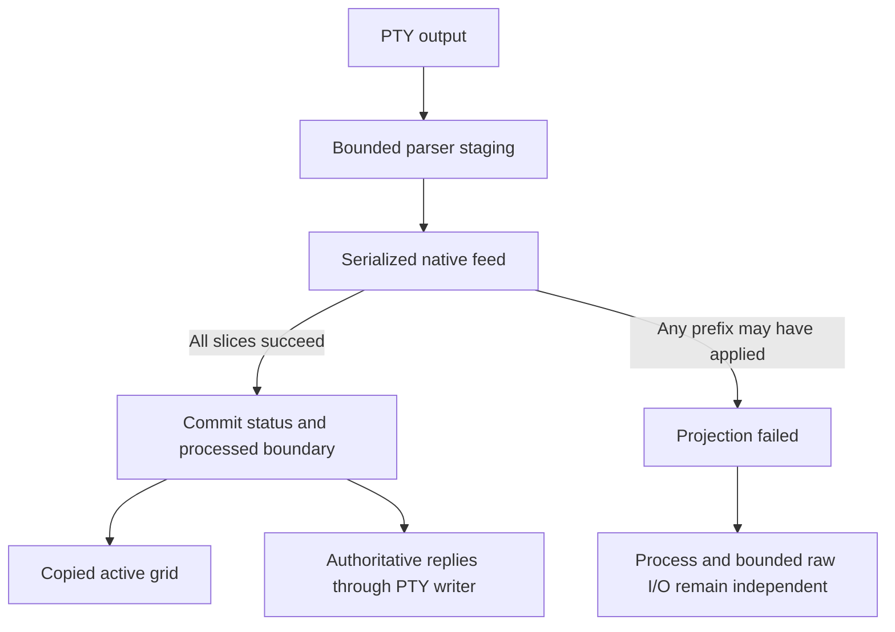

# Read a screen with its processing boundary

A projected session maintains one authoritative terminal model. Ask
`projected_view()` for an admitted copy of its active grid and inspect
`projection_status()`: published is output admitted to parser staging; processed
is output successfully applied. A view is not automatically current through all
published bytes. Raw sessions have no projection to observe.

## Failed feed is not a retryable chunk

Native feed can mutate a prefix before failing. The worker retains original bytes
for diagnosis, fails projection and does not replay them into that mutated model.
No empty replacement is silently created. Check failure and retain raw output for
diagnosis; no general in-place recovery from a failed projection is promised.
At the parser staging cap, backpressure applies to this session. Cancellation and
supervision have separate ownership.

Snapshots retain quota until dropped; copying their borrowed contents makes a
separate caller allocation. Terminal modes preserve distinctions needed to encode
mouse/input events. Clipboard/desktop policy is the embedding application's concern.
A native crash can end the owner process; a Rust wrapper is not process isolation.

## History belongs to the terminal port

`ITerminal::history(start, count)` is a bounded read-only range query. The public
Session facade exposes active views/checkpoints/transfers, not a history method.
The demo owns an ITerminal directly and uses its history API. Row indices are
relative to the current retained window, not stable historical IDs; eviction and
incremental restoration change what can be read. Counts help re-anchor, but do not
prove all prior history is present. Viewport position belongs to each consumer.
See [ADR 0006](../adr/0006-scrollback-projection.md) and [parking](parking.md).
