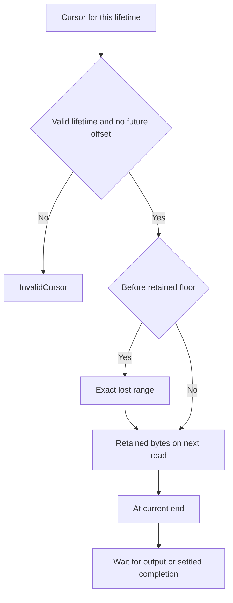

# Resume output after a viewer disconnects

Keep the last cursor returned by an Attachment and reconnect to the same Session
with `AttachPosition::Cursor`. The cursor combines runtime/session lifetime with
a byte offset. A reused ID or future position is rejected. `Oldest` begins at the
currently retained floor; `Tail` deliberately skips existing output.

## A gap needs an explicit reader decision

If byte positions 0..99 are gone and the caller asks at 50, the next event names
50..100 as a gap; later reads return retained bytes starting at 100. Show that loss
to a log reader. A terminal emulator needing complete state should request a
[checkpoint transfer](transfer.md) from a projected session, rather than guess
missing escape sequences from a suffix. Raw replay cannot rebuild arbitrary lost
terminal state.

Each attachment has an independent cursor and no output queue of its own. A read
advances only when a ready event is returned; cancelling a pending read leaves
its cursor unchanged. Returned bytes are not a child-acknowledgement protocol.
Completion follows retained output/gaps in cursor order; Pending is not EOF.

Replay is a bounded, evictable tail with separate local and shared reservations.
Parser staging is lossless up to its own cap and can backpressure that session;
observer loss cannot excuse dropping authoritative parser input. Released logical
bytes, allocated capacity and OS memory are different quantities.

ReplayAdmission models offsets 0..3, a two-byte retained tail and two lifetime
identities. It checks accepted reads have a valid lifetime and a lost prefix is
reported before data. It excludes payload contents, attachment quotas, concurrent
wakers and buffer allocation arithmetic.
