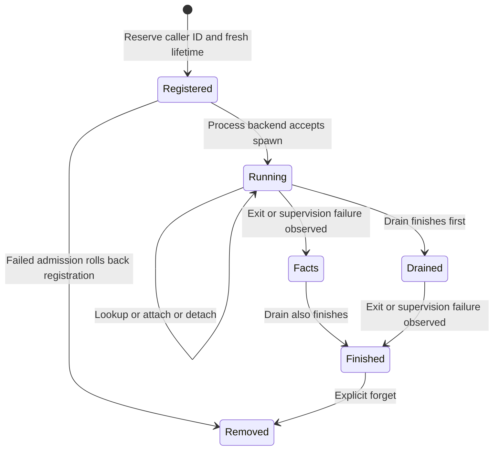

# Start once and reconnect to the same child

Create Runtime before starting worker threads: the built-in helper-image staging
forks, and other threads' platform locks can deadlock that construction. The
[embedding guide](../usage.md) and [interactive example](../../examples/interactive.rs)
show the supported composition. Choose raw or projected SessionOptions at spawn;
mode is fixed for that lifetime. The default ghostty feature supplies projection
services. A raw-only build or composition without them returns Unsupported for
projected spawn; use `with_projection_adapters` to supply compatible services.

Use `spawn(id, command, options)` once. An existing registered ID returns
ExistingSession, including after completion; use `lookup(id)` to observe it.
Reserve a business-level ID in the host if several requests could race. The
library does not persist that registry across owner restart. Spawn errors roll
back the reserved entry; no error is manufactured into a successful child exit.

## Finish is a pair of facts

`wait()` reserves an observer and waits for a supervision outcome **and** a drain
outcome. Read `Completion.status`: `exit` is an actual reaped exit; supervision or
admission failures are separate. Drain can be EOF, truncated or failed. A child
can exit while descendants keep output open; a drain deadline is not proof of
complete output. Finished therefore means observation is settled, not successful.
After recording the result, call `forget(id)` to release a completed registry
entry. Forget refuses unfinished work. Reusing the ID creates a new lifetime;
old handles and cursors still address the old one.

## Who owns unfinished work

Dropping Session, Attachment or a completion wait does not terminate the child.
Keep Runtime alive across ordinary viewer disconnects. Explicit `shutdown()`
rejects new spawns, shuts down the backend, waits admitted spawns and projection
workers. Runtime Drop uses immediate backend shutdown. Inspect cancellation and
completion evidence when the outcome matters; process-group escape and hostile
unbounded forking are outside the documented Guardian cleanup scope.

The bounded CompletionFacts model checks the required pair and that failure does
not invent exit. It excludes OS signaling, registration rollback, waiting time,
Guardian algorithms and eventual cleanup. Existing tests exercise those separately.
