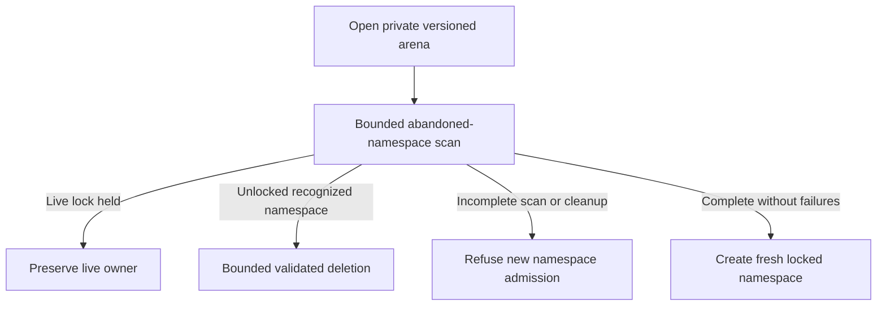

# Treat disk checkpoints as live-owner state

The built-in store creates a private namespace under a trusted parent and stores
authenticated encrypted bytes. Its key exists for the Runtime lifetime. A file on
disk is neither a recoverable running process nor a promise that a replacement
Runtime can decrypt and resume it. Normal teardown removes owned objects best
effort; failures retain accounting and evidence rather than imply reclamation.

## Capacity can mean unfinished maintenance

Every incomplete scan blocks new admission, even when the examined prefix contains
only live owners. Inspect the cleanup report; choose larger finite cleanup limits
or reduce the live population and retry. Known abandoned objects exceeding the
deletion budget also block admission. Locks identify live owners; PID guessing and
recursive deletion are not used. Foreign/legacy directories outside the arena are
not discovered. The trusted parent must not be replaced maliciously during use.

Logical ciphertext quotas include temporary and committed files; filesystem block
rounding/cache and encryption buffers are separate. A failed delete is not freed
capacity. Injected stores must keep published objects immutable and readable until
released, support bounded reads and preserve explicit uncertain outcomes. They do
not receive plaintext from the default protector. Checkpoint compatibility and
byte/control metadata are validated separately from encryption authenticity.

No atlas model proves encryption, filesystem race safety, crash cleanup or power
loss. Current gate results and existing storage contract tests are listed under
[evidence](verification.md); the full release matrix remains separate.
