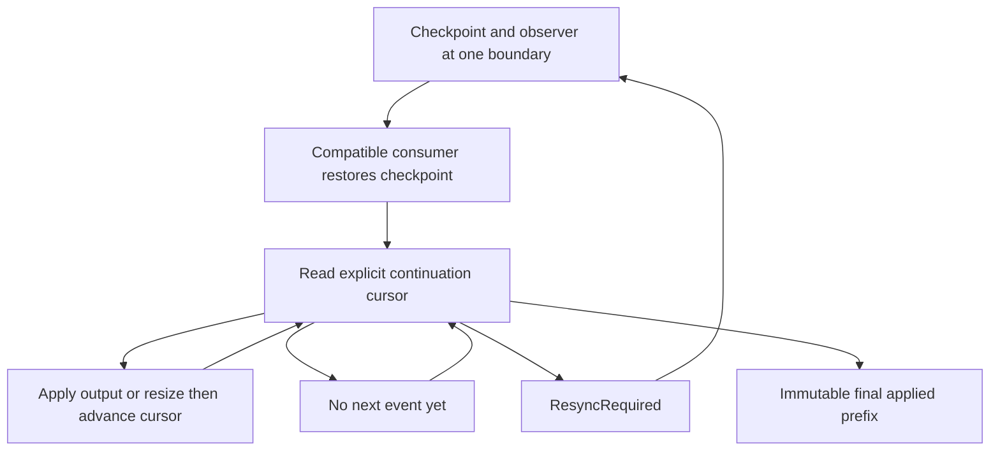

# Rebuild a compatible viewer from a checkpoint

Call `begin_transfer()` on a projected session. Restore its checkpoint into a
compatible terminal engine, then consume its observer from the returned boundary.
Apply original output and successful resize events in sequence. Discard replies
that the viewer's model generates: only the authoritative server writes them to
the child. A raw byte cursor cannot substitute for this sequence because resize
changes state without consuming output bytes.

## End and loss need different decisions

`TransferEvent::after().cursor` is the next position after applying that event.
Read does not advance the caller's cursor; cancelling a wait only clears its
notification. If retention is lost, discard the partial reconstruction and request
a fresh transfer. Do not skip to the oldest retained event on an old checkpoint.

End describes the final successfully applied prefix. Inspect its drain and
projection_failure: a failed prefix is not parser catchup or a successful process
exit. Pending is not End. The first End remains immutable; later observations do
not upgrade an earlier failure. Runtime closure rejects old observers.
Checkpoint pins and returned events retain quota until dropped; slow consumers
can exhaust their own allowed observations without creating an unbounded queue.

TransferSeal checks one bounded stream's sealed boundary cannot advance and a
successful ending needs a drain fact. It includes a failed-prefix ending without
drain. It does not prove checkpoint compatibility, payload equivalence, reply
suppression, journal retention or multi-consumer transport correctness.
